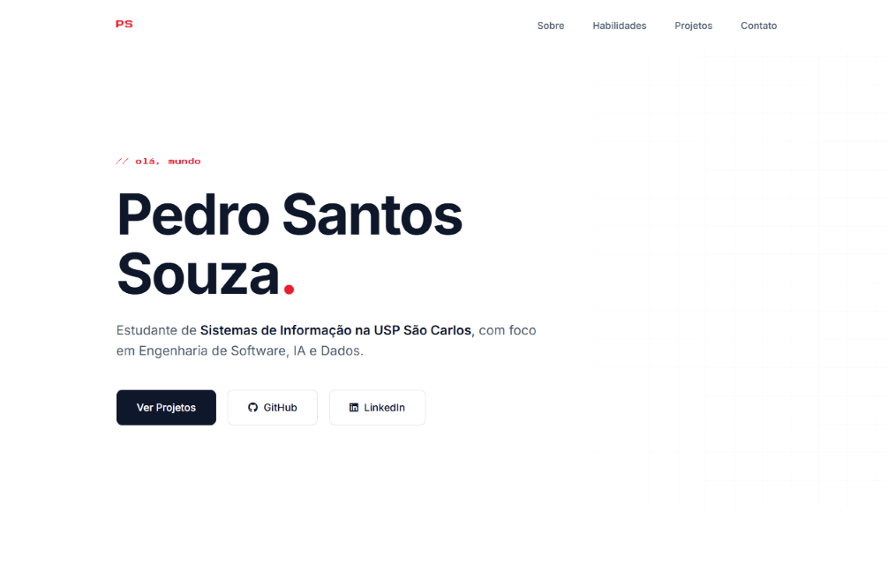

# Portfólio — Pedro Santos Souza

Repositório do meu site pessoal, onde reúno meus projetos principais, tecnologias que utilizo e formas de contato.

🔗 **Acesso:** [pedrosasouza.github.io](https://pedrosasouza.github.io)

## Sobre o código

Este repositório contém o código-fonte do meu portfólio pessoal, desenvolvido para apresentar minha trajetória acadêmica, projetos e conhecimentos em tecnologia.

O site apresenta um pouco da minha trajetória acadêmica, projetos que desenvolvi e tecnologias com as quais tenho trabalhado.

- `index.html` — estrutura das seções (Sobre, Habilidades, Projetos e Contato)
- `css/style.css` — estilização, tipografia e responsividade
- `js/main.js` — menu mobile e animações leves na rolagem

Para rodar localmente, basta abrir o arquivo `index.html` direto no navegador.

## Licença

Distribuído sob a licença [MIT](LICENSE).
